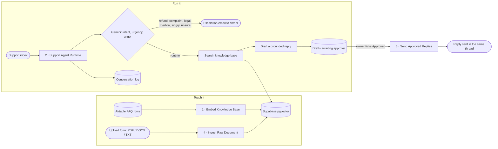

# AI Support Agent

An email support agent that reads every incoming message, answers routine questions from the business's own knowledge base, and sends anything angry, sensitive or uncertain straight to a human. Nothing goes out without the owner's approval. Built on n8n, Gemini and Supabase pgvector.

**The problem.** The inbox fills with the same ten questions. The one urgent complaint is buried under them and gets answered on Thursday.

**What this does.** Every email is classified by intent and urgency. Routine questions get a reply drafted from the business's own documents, in their tone, and waiting for one-click approval. Refunds, complaints, legal or medical language, detected anger, or low confidence skip the AI entirely and land in the owner's inbox with the full context. Every conversation is logged.

## Status

| Part | State |
|---|---|
| Teaching the knowledge base from uploaded PDF, DOCX or TXT files | **Proven live** (2 real documents ingested) |
| Reading the inbox, parsing sender, subject and time correctly | **Proven live** |
| Escalation emails with full context | **Proven live** |
| Conversation log written to Airtable | **Proven live** (every field populated) |
| Answer path: search knowledge base → draft → approve → send | Built, **not yet completed end to end.** It found 3 real matches on the first run, then dropped them on a field-name bug (fixed). Every retest since hit Gemini free-tier rate limits |
| Paying clients | None yet |

## How it works

| # | Workflow | Trigger | Nodes | Job |
|---|---|---|---|---|
| 1 | [`1-embed-knowledge-base`](workflows/1-embed-knowledge-base.json) | Manual | 20 | Turns the FAQ table into searchable vectors |
| 2 | [`2-support-agent-runtime`](workflows/2-support-agent-runtime.json) | Gmail, every minute | 40 | Classify, escalate or answer, draft, log |
| 3 | [`3-send-approved-email-replies`](workflows/3-send-approved-email-replies.json) | Schedule | 12 | Sends only the drafts a human approved, in the original thread |
| 4 | [`4-ingest-raw-document-form-upload`](workflows/4-ingest-raw-document-form-upload.json) | n8n form | 10 | Adds a document to the same knowledge base, without wiping what's there |

Sending lives in its own workflow on purpose: you can pause all outgoing mail without pausing the inbox watcher.

## What I built in on purpose

- **It never invents policy.** If the answer isn't in the knowledge base, it escalates instead of guessing.
- **A human approves every reply** before it's sent.
- **Escalation triggers:** refund requests, complaints, legal or medical language, detected anger, and anything the model is unsure about.
- **When the AI fails, it escalates.** A rate-limited classifier produces an escalation with the reason "Classification call failed after retries", never a guess.
- **Every external call has an error path**, including the vector store, which needed a different pattern (see bug 3).

## Bugs I found and fixed

1. **A self-feeding email loop.** The escalation address had a one-letter typo. Every alert bounced, the bounce landed back in the watched inbox from `mailer-daemon` (not `me`, so the filter didn't catch it), and the bounce triggered a new escalation. Once a minute, until it drained the day's AI allowance. Fixed at both ends: the address, and a trigger filter that ignores `mailer-daemon`, `postmaster` and delivery notifications so a bounce can never restart it.
2. **Gemini embeddings are 3072 dimensions, not 768.** n8n's node description says 768. Every insert failed until I read real execution data and rebuilt the Supabase table as `vector(3072)`.
3. **The vector store fails differently.** Its error output carries no `error` field, so an IF node checking `$json.error` reported success on a real failure. Switched to the node's own error output and wired both branches directly.
4. **Every message had a blank sender and subject.** The Gmail trigger's simplified output capitalises `From` and `Subject` and has no `date` field. The normaliser now reads those, with lowercase fallbacks.
5. **Airtable silently rejected every log row** with `422 INVALID_VALUE_FOR_COLUMN`. The field types cached inside the n8n node said boolean; the real columns were text. One bad field makes Airtable discard the whole record. Lesson: check the real column type in Airtable, never the node's cached schema.
6. **n8n auto-attached the wrong existing credentials** to new nodes, twice. Validation showed 0 errors both times. Only fetching the live node config showed it.
7. **A 15-minute poll used the whole Airtable monthly allowance.** 96 runs a day whether or not anything was waiting. Workflow 3 is off until it has a gate and a gentler schedule.

## Set it up

You need: n8n, Gmail, a Gemini API key, a Supabase project, and an Airtable base.

1. **Supabase:** enable the `vector` extension, create a `documents` table with an `embedding vector(3072)` column, and a `match_documents()` function (the standard LangChain/Supabase recipe, with 3072 in place of 1536).
2. **Airtable base** with three tables:
   - `Knowledge Base`: Question, Answer, Category, Active (checkbox), Embedding Status, Last Embedded At, Embed Error Message
   - `Email Drafts Pending Approval`: Customer Email, Subject, Draft Body, Original Gmail Message ID, Original Gmail Thread ID, Approved (checkbox), Sent (checkbox), Sent At, Send Error
   - `Conversation Log`: Channel, From, Message Text, Received At, Intent, Urgency, Detected Anger, Escalated, Escalation Reason, Response Text, Response Status
3. **Import** the four files in `workflows/`, attach your logins, and replace the `appREPLACEWITHBASE` / `tblREPLACEWITHTABL` placeholders and `you@example.com`.
4. Add 5 to 10 made-up FAQ rows, run workflow 1, and check rows with real vectors landed in Supabase.
5. Switch on workflow 2. Change workflow 3's 15-minute schedule to daily (or run it by hand) before switching it on, unless you're on a paid Airtable plan.
6. Test in this order: a normal question, an angry refund demand (must escalate, not answer), then approve a draft and check it arrives in the same thread.

## Known gaps

- **Email only.** WhatsApp was cut from v1 because Meta's business verification had no clear timeline. The pipeline is channel-agnostic: a new channel is a new trigger plus a normaliser, not a rebuild.
- **One document per upload, no OCR,** and re-uploading a document adds chunks rather than replacing the old ones.
- **Free Supabase projects pause** when idle, which quietly breaks retrieval.
- It's only as good as the knowledge base behind it.

## Stack

n8n · Google Gemini (chat + embeddings) · Supabase pgvector · Airtable · Gmail

Part of my [automation systems](https://github.com/krey-builds). Workflows were cleaned for publishing with [n8n-sanitize](https://github.com/krey-builds/n8n-sanitize). Built with Claude Code. MIT licence.
